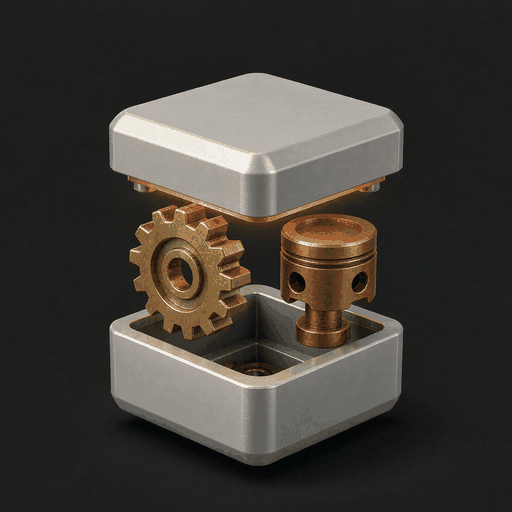

# Anatomy 中文版 · 等轴测交互说明图生成



> 把一个技术概念，画成一台真实、精密、会动的机器。
>
> 开源项目 [Anatomy](https://github.com/wheresryan22/anatomy)（MIT 许可，© 2026 Ryan）的中文版封装，全部功能与原版一致。

## 这是什么

Anatomy 是一个 Agent 技能：当你想把「某个概念、算法、系统或组件的工作原理」讲清楚时，它不画方块、箭头和标签，而是**发明一台真实的机械装置**，让装置的运转方式本身就是解释。

读者之所以一眼读懂，是因为他们认出了这台机器——带蹄脚的厚重底座、带刻度的导轨、衬套上的滑架、滚花旋钮、螺旋弹簧、指针会转的表盘、做成细点的螺钉。图上出现的每一个数字，都来自驱动零件运动的同一个模型。

成品是这样的图：

- **等轴测（isometric）视角**，由后向前正确遮挡，近处遮住远处；
- **大量精密小零件**（Figure 40–80 个，Hero 80–150 个），四阶明暗、倒角、滚花、标尺刻度、铭牌；
- **带框卡片**：编号、标题、交互提示、右下角实时读数；
- **可交互**：指针、键盘响应，空闲巡游，离开视口停止，尊重系统「减弱动态」；
- **可选 WebGL 特效**：火焰、尾气、水流、焦散、灯光，与等轴测视角同一世界空间；
- **可选 3D 模式**（beta）：拨盘真实旋转、手指屈伸、部件断裂脱落。

## 适合谁

- 写技术文档、博客、公众号、落地页、产品官网，需要「高级感」解释性配图的人；
- 做科普与教学材料，要把抽象原理变直观的人；
- 设计师与前端：需要 Linear 风格 / premium 技术插画的人；
- 需要把「一次讲清」当生产力的团队：技术传播、产品营销、开发者关系。

## 快速开始

装好技能后，直接说：

```
/anatomy 解释令牌桶限流器的工作原理，要交互式，单个 HTML 文件，深色主题
```

不点名技能也行，直接描述需求即可触发：

- 「画一张等轴测图解释 CDN 边缘缓存，命中与未命中，TTL 60 秒」
- 「给我的 Next.js 文档配一张数据库连接池说明图：10 个连接，借出归还，满了排队」
- 「一台本生灯：开大空气套管，黄焰变成蓝锥。WebGL 火焰，深色主题」

三条建议获得最佳效果：

1. **给真实数字**：令牌 20 个、每秒补 5 个、TTL 60 秒——图上的读数会全部为真；
2. **说清用途**：文档 / 博客 / 落地页、深色还是浅色主题、单 HTML 还是 React 组件；
3. **让它验收**：技能自带几何审计与截图校验，会让 AI 先把图放大 4× 自查再交付。

## 输出形态

| 形态 | 说明 |
| --- | --- |
| 独立 HTML 页面 | 单文件、可直接打开，含交互与读数 |
| 静态 SVG | `figureSvg({ standalone })`，样式内嵌，适合文档与博客 |
| React / Next.js 组件 | `kit-react/` 提供服务端组件与客户端钩子，直接进项目 |
| WebGL 增强 | 着色器活在图的同一等轴测相机里，三层结构不跳变 |
| 3D 图（beta） | `kit/turn*.mjs`，凸体零件真实旋转、材质、断裂自由体 |

## 质量怎么保证

这是 Anatomy 区别于「AI 画示意图」的核心——它带一整套机器验收：

- **几何审计**（`kit/audit.mjs`）：证明没有任何零件穿模、每个端头落在真实安装座上、每一处重叠按真实深度顺序绘制（`node build.mjs --audit`）；
- **线条检查**（`scripts/lines.mjs`）：每条接缝、刻度、指针都必须终止在笔画、圆点或轮廓上，不允许有飘在空中的线；
- **截图评审**（`scripts/capture.mjs`、`drive.mjs`）：headless Chrome 截图、特写、慢放连拍，专抓跳变与色换；
- **4× 放大自查**：交付前逐区域放大，光秃的面算未完成。

八个完整示例随包交付，从 300 行的最小表盘到 240 零件的街机，可直接打开对照。

## 包内结构

```
anatomy-zh/
├── SKILL.md            技能主文件：工作流、配置与工艺规则（中文）
├── README.md           本文件
├── LICENSE             MIT 许可（保留原作版权声明）
├── _icon.png           技能图标（512×512，取自 Anatomy 官方标志，已压缩优化）
├── kit/                绘图工具库（代码与原版一致）
│   ├── iso-kit.ts / .mjs   核心：相机、实体、零件库、渲染器、CSS
│   ├── lathe.mjs           任意轴圆形零件
│   ├── tube.mjs            管路与线缆
│   ├── audit.mjs           几何审计
│   ├── gl.mjs              图内 WebGL 层
│   ├── turn*.mjs           3D 运行时（beta）
│   └── react/              React 组件与钩子
├── references/         九篇中文详档：工艺、API、动效、React、验收、WebGL、3D、设计走查、发布
├── scripts/            浏览器校验与构建辅助脚本
├── examples/           八个完整示例（含已构建页面）
└── evals/              评测提示词
```

## 上架素材清单（应用市场表单上传用）

以下官方品牌资产**不随技能包分发**（市场对包体有限制），上架时从商品表单单独上传。文件位于作者素材库 `outputs/anatomy-marketplace/logo/`：

| 文件 | 用途 |
|---|---|
| `anatomy-icon-512.png` | 应用图标（512×512，与包内 `_icon.png` 同源，表单请传未压缩原版） |
| `anatomy-banner-1200x400.png` | 市场横幅（1200×400） |
| `anatomy-cover-1200x630.png` | 市场封面（1200×630） |
| `anatomy-hero-1600.png` | 商品页主视觉（1600 宽） |
| `anatomy-mark-transparent.png` | 官方标志主文件（透明底：浮起盖子的金属机匣 + 黄铜齿轮 + 铜活塞） |
| `anatomy-mark-light.png` | 标志浅色底变体 |
| `anatomy-icon-32/48/64/128/256.png` | 图标其他尺寸（备用） |

## 运行要求

- **Node.js 20.10+**（构建、工具库、检查；无任何 npm 依赖，纯内置模块）；
- **Chrome 或 Chromium**（可选）：仅截图与浏览器校验需要，不装也能生成图；
- **React 18+**（可选）：仅 React 输出路径需要。

## 社区画廊（可选）

想分享作品时，可发布到 Anatomy 社区画廊（GitHub）。该功能**仅在明确要求时执行**，不会自动外传任何数据，且需要本机可访问 GitHub。详见 `references/publish.md`。

## 授权与致谢

本技能为开源项目 Anatomy 的中文版封装，遵循 MIT 许可，保留原作版权声明（© 2026 Ryan，@wheresryan22）。中文版封装与维护：令狐杨过 JW。上游仓库：https://github.com/wheresryan22/anatomy
